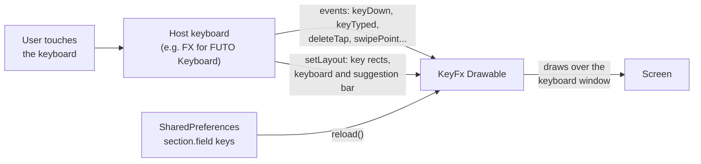
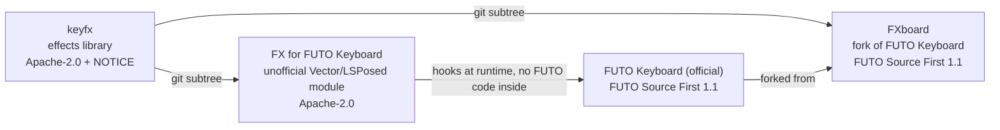

# keyfx

[](https://ko-fi.com/theoerickson)
[](LICENSE)

**An effects library for Android keyboards.** Key pops, floating letters, backspace fire and black holes, swipe trails, letter hop, hold charge, a spacebar trackpad and show and hide animations, all drawn by one `Drawable` that any keyboard can host.

> [!NOTE]
> keyfx, FX for FUTO Keyboard and FXboard are independent, unofficial projects by Theo Erickson. They are not made, endorsed or supported by FUTO.

<!-- Media: a short GIF of a few effects in action goes here, e.g.  -->

keyfx is the engine behind [FX for FUTO Keyboard](https://github.com/Theo-Erickson/futo-tweaks), and is being built into [FXboard](https://github.com/Theo-Erickson/fxboard).

## Contents

- [Summary](#summary)
- [Downloads](#downloads)
- [The effects](#the-effects)
- [Related projects](#related-projects)
- [The lab](#the-lab)
- [How it works](#how-it-works)
- [The host API](#the-host-api)
- [Writing a host](#writing-a-host)
- [Adding keyfx to a project](#adding-keyfx-to-a-project)
- [FAQ](#faq)
- [Support](#support)
- [Licensing](#licensing)

## Summary

Most keyboards draw their keys and stop there. keyfx adds a layer on top: a single `Drawable` (`KeyFx`) that sits over the keyboard window and draws every effect. The keyboard, called the **host**, only reports what the user does (a key went down, a letter was typed, backspace deleted these three letters, a swipe passed through these points), and keyfx decides what to draw.

- **Keyboard-agnostic.** keyfx uses plain Android graphics only. It contains no code from FUTO Keyboard, LatinIME or any other keyboard, and no Xposed code.
- **Settings-driven.** Every effect and every value is described by a schema (`Section` and `Field`), so a host can generate its settings screen instead of hand-building one.
- **Live.** Settings changes apply at once with `reload()`, even while the keyboard is open.
- **Polite.** Effects switch off when Android's "Remove animations" setting is on, and follow the Material You accent unless you choose a color.
- **Capability-aware.** A host declares what it can do. Effects that need deeper access (moving real keys, styling the suggestion bar) are hidden from hosts that can't provide it.

## Downloads

keyfx is a library, so it has no APK of its own. To try the effects on a phone, install one of the apps that use it:

| I want to... | Get this |
|---|---|
| Keep the official FUTO Keyboard and add effects (root with LSPosed or Vector) | [FX for FUTO Keyboard releases](https://github.com/Theo-Erickson/futo-tweaks/releases) |
| Install a standalone keyboard with effects built in (no root; keyfx is still being wired in) | [FXboard releases](https://github.com/Theo-Erickson/fxboard/releases) |
| Try the effects in a browser and design my own settings | [Open the lab](https://theo-erickson.github.io/keyfx/) (runs in any browser, phone included) |
| Use keyfx in my own keyboard | [Adding keyfx to a project](#adding-keyfx-to-a-project) |
| Get the source | [Download ZIP](https://github.com/Theo-Erickson/keyfx/archive/refs/heads/main.zip) or `git clone https://github.com/Theo-Erickson/keyfx.git` |

## The effects

| Group | Effects |
|---|---|
| Typing | Key pop (scaling the real key in hosts with `CAP_KEY_TRANSFORM`), letter float (rise, grow or ghost key), heat streak, neighbor wave, ripple, sparks |
| Special keys | Enter sweep; spacebar stars, puff or shimmer; backspace fire, slash or shatter, with the deleted letters burning, splitting or shattering too |
| Backspace hold | The key becomes a black hole, lava (shaking the real key in hosts with `CAP_KEY_TRANSFORM`), an opening box or a hole, and the deleted letters swirl in, fly on curves, or get one press each |
| Swipe trail | Key trace, comet, ink brush, stardust |
| Swipe word | Letter hop on the number row (or the top row), constellation, commit burst |
| Long press | Hold charge, as a ring or a liquid fill |
| Spacebar | Trackpad mode, with key labels fading out (hosts with `CAP_KEY_TRANSFORM`) |
| Show and hide | Center bloom or row cascade on show, key by key in hosts with `CAP_KEY_TRANSFORM`; a dip on hide (hosts with `CAP_HIDE_ANIMATION`) |
| Accent popup | Bloom arc layout (hosts with `CAP_POPUP_LAYOUT`) |
| Suggestion bar | Light up the predicted word (hosts with `CAP_SUGGESTION_STYLE`) |

When one press removes a whole word (like undoing a swiped word), every letter in it gets the backspace effect, not only the last one.

## Related projects

| Project | What it is | Who it's for | License |
|---|---|---|---|
| **keyfx** (this repo) | The effects library | Keyboard developers | Apache-2.0 |
| [FX for FUTO Keyboard](https://github.com/Theo-Erickson/futo-tweaks) | An unofficial LSPosed / Vector module that adds keyfx to the official FUTO Keyboard app at runtime | Rooted phones that want to keep the official FUTO app and its updates | Apache-2.0 |
| [FXboard](https://github.com/Theo-Erickson/fxboard) | An FX keyboard: a fork of FUTO Keyboard with keyfx built in | Anyone, no root needed | FUTO Source First 1.1 |
| [FUTO Keyboard](https://keyboard.futo.org) (official) | The offline, private keyboard both apps build on. Not affiliated with these projects | Everyone | FUTO Source First 1.1 |

## The lab

The effects were designed in the lab, a mock keyboard in a single HTML file with a slider and a live preview for every setting. **[Open the lab](https://theo-erickson.github.io/keyfx/)** in any desktop or phone browser, or download [`lab/index.html`](lab/index.html) to use it offline.

The lab's section ids and setting keys match keyfx's schema exactly. Press **Export settings** in the lab, then paste the result into a host's **Import** box (FX for FUTO Keyboard and FXboard both have one) to copy your design to your phone. Anything the host doesn't support is skipped.

## How it works



1. The host adds `KeyFx` to an overlay covering the keyboard window.
2. The host tells keyfx where every key is (`setLayout`), in the Drawable's own coordinates.
3. As the user types, the host calls the event methods. keyfx runs the effects and invalidates itself while anything is animating.
4. Settings live in one `SharedPreferences`. The host calls `reload()` after a change.

## The host API

```java
// Layout and settings
fx.setLayout(FxLayout layout);          // keys + keyboard rect + suggestion rect, layer coordinates
fx.reload();                            // re-read settings (live reload)
fx.setSystemAccent(int color);          // Material You accent for accent = "system"
fx.setEnabled(boolean animationsOn);    // off when Android's "Remove animations" is on

// Events
fx.keyDown(FxKey k, float x, float y);
fx.keyTyped(FxKey k, String glyph, float x);           // glyph as typed, capitals included
fx.deleteTap(FxKey k, FxLetter... letters);            // everything one press deleted, text order
fx.deleteHoldStart(FxKey k); fx.deleteHoldLetter(FxLetter l); fx.deleteHoldEnd();  // hold: one call per letter, right to left
fx.longPressStart(FxKey k, float x, long timeoutMs); fx.longPressEnd();
fx.swipeStart(); fx.swipePoint(float x, float y, long t); fx.swipeEnd(); fx.swipeWord(String word); fx.swipeCancel();
fx.swipeGuess(String word);             // live best guess during a swipe, for the word highlight
fx.cursorMode(boolean on, float x, float y); fx.cursorMove(float x, float y);
fx.show(Bitmap snapshot, Runnable onDone);  // returns true if animating; host hides its view until onDone
fx.hide(Bitmap snapshot, Runnable onDone);  // CAP_HIDE_ANIMATION hosts only

// Hosts that draw more than the overlay
fx.setHost(FxHost host);                // redrawKeys() and wordChanged() callbacks
fx.look(FxKey k, KeyLook out);          // CAP_KEY_TRANSFORM: scale, move, fade this real key now
fx.showNeedsSnapshot();                 // false: call show(null, onDone), keys animate through look()
fx.word();                              // CAP_SUGGESTION_STYLE: the predicted word and lit letters
fx.popupLayout(FxKey k, int n, RectF bounds, float[] outXY);  // CAP_POPUP_LAYOUT: bloom arc
fx.popupLook(int i, long msSinceOpen, float keyCx, float keyCy, float itemX, float itemY, KeyLook out);
KeyFx.capTitle(int cap); KeyFx.capReason(int cap);  // wording for settings screens
```

## Writing a host

1. **Attach.** Create a `KeyFx` and add it to an overlay that covers the keyboard window.
2. **Layout.** Build an `FxLayout` of `FxKey`s in the Drawable's coordinates, with the keyboard and suggestion bar rectangles, and call `setLayout()` whenever the keyboard changes (new layout, rotation, symbols page).
3. **Events.** Call the event methods from the points where your keyboard handles touches, typed keys, backspace and swipes.
4. **Capabilities.** Declare what your host can do beyond drawing on top, with the `KeyFx.CAP_*` flags. Settings and sections that need a missing flag are hidden from that host's settings screen.

   | Flag | Lets keyfx |
   |---|---|
   | `CAP_KEY_TRANSFORM` | scale, shake and fade the real keys through `look()`: key pop, lava shake, trackpad label fade, key-by-key show |
   | `CAP_SUGGESTION_STYLE` | light up the predicted word in the suggestion bar through `word()` |
   | `CAP_POPUP_LAYOUT` | lay out the accent popup as a bloom arc through `popupLayout()` and `popupLook()` |
   | `CAP_EXACT_WORD` | use the exact swiped word instead of a guess from committed text |
   | `CAP_HIDE_ANIMATION` | play the hide dip |

   Hosts with any of the first three also call `setHost()`, so keyfx can ask them to redraw.

5. **Settings.** keyfx reads one `SharedPreferences`, keys `"<sectionId>.<fieldKey>"`, with `"<sectionId>.on"` for sections that can be switched off. Ranges are floats and choices are strings. `Section` and `Field` describe every setting, so a host can generate its settings screen from them. Call `reload()` after a change to apply it at once.

## Adding keyfx to a project

keyfx is meant to be copied in with `git subtree`, so it arrives as plain files with no extra tooling, and anyone cloning your project gets it without submodules.

```bash
# Add keyfx to a project (once)
git remote add keyfx https://github.com/Theo-Erickson/keyfx.git
git subtree add --prefix=keyfx keyfx main --squash

# Pull keyfx updates
git subtree pull --prefix=keyfx keyfx main --squash

# Send fixes made inside keyfx/ back to the keyfx repo
git subtree push --prefix=keyfx keyfx <branch-name>
```

Then add `keyfx/src/main/java` to your app module's source set, or include it as a library module.

## FAQ

**Can I use keyfx in my own keyboard, including a paid one?**
Yes. keyfx is Apache-2.0. Keep the `LICENSE` and `NOTICE` files with your distribution and say what you changed. A credit link back here is appreciated but not required.

**Does keyfx need root or Xposed?**
No. keyfx is an ordinary library. Root is only needed by FX for FUTO Keyboard, which uses LSPosed to add keyfx to an app it can't rebuild.

**Does keyfx collect or send any data?**
No. It has no network code and no analytics. It sees only the events its host gives it and keeps nothing after an effect finishes.

**Will it slow down typing?**
Effects are drawn with plain `Canvas` calls, and keyfx only redraws while something is animating. Every effect can be switched off, and all of them switch off with Android's "Remove animations" setting.

**Why `git subtree` and not a Maven package?**
Hosts like FXboard need to build fully from source with no extra repositories, and subtree keeps the files plainly visible in the host. A published package may come later.

**Why are some settings missing in my app?**
They need a capability the host doesn't have. For example FX for FUTO Keyboard can't restyle FUTO's suggestion bar, so that setting will only appear in FXboard.

**Is this made by FUTO?**
No. keyfx, FX for FUTO Keyboard and FXboard are independent projects by Theo Erickson, and are not affiliated with or endorsed by FUTO.

**Where do I report a bug?**
Effect bugs (drawing, timing, settings) go in [keyfx issues](https://github.com/Theo-Erickson/keyfx/issues). Problems with hooking FUTO go to [FX for FUTO Keyboard](https://github.com/Theo-Erickson/futo-tweaks/issues), and problems with the fork to [FXboard](https://github.com/Theo-Erickson/fxboard/issues). Please don't report any of them to FUTO.

## Support

keyfx is free and always will be. If you enjoy the effects, in any app that uses them, you can support keyfx on [Ko-fi](https://ko-fi.com/theoerickson). Donations go to keyfx, the library, and to FX for FUTO Keyboard, which is also Apache-2.0. FXboard, as a fork of FUTO Keyboard, takes no donations itself.

## Licensing



| Project | License | Notes |
|---|---|---|
| keyfx | Apache-2.0 | Ship the `NOTICE` file with any distribution. |
| FX for FUTO Keyboard | Apache-2.0 | Contains no FUTO code; it hooks the official app at runtime. |
| FXboard | FUTO Source First 1.1 | The fork as a whole. The `keyfx/` folder inside it keeps its Apache-2.0 license and NOTICE. |

keyfx is licensed under the [Apache License 2.0](LICENSE). Copyright 2026 Theo Erickson.

keyfx, FX for FUTO Keyboard and FXboard are not affiliated with or endorsed by FUTO. FUTO and FUTO Keyboard are trademarks of FUTO Holdings, Inc., named here only to describe which keyboard the other projects work with. These projects claim no rights to them.
