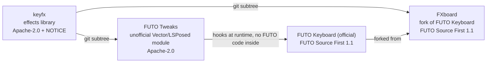

# keyfx

[](https://ko-fi.com/theoerickson)

keyfx is an effects library for Android keyboards. One `Drawable` (`KeyFx`) sits over the keyboard window and draws every effect: key pops, floating letters, heat streaks, backspace fire and black holes, swipe trails, letter hop, hold charge, the spacebar trackpad, and show and hide animations. The keyboard (the host) reports what the user does, and keyfx does the drawing.

It uses plain Android graphics only, with no code from any particular keyboard, so any keyboard can host it.

## Projects that use keyfx

- [FUTO Tweaks](https://github.com/Theo-Erickson/futo-tweaks): an unofficial Vector / LSPosed module that adds keyfx to the stock FUTO Keyboard app.
- [FXboard](https://github.com/Theo-Erickson/fxboard): an FX keyboard, a fork of FUTO Keyboard with keyfx built in.

The effects were designed in the lab (`lab/`), a mock keyboard in a single HTML page with a slider and preview for every setting. Its section ids and keys match keyfx's settings, so its export imports straight into a host's settings.

## The host API

```java
// Layout and settings
fx.setLayout(FxLayout layout);          // keys + keyboard rect + suggestion rect, layer coordinates
fx.reload();                            // re-read settings (live reload)
fx.setSystemAccent(int color);          // Material You accent for accent = "system"
fx.setEnabled(boolean animationsOn);    // off when Android's "Remove animations" is on

// Events
fx.keyDown(FxKey k, float x, float y);
fx.keyTyped(FxKey k, String glyph, float x);           // glyph as typed, capitals included
fx.deleteTap(FxKey k, FxLetter... letters);            // everything one press deleted, text order
fx.deleteHoldStart(FxKey k); fx.deleteHoldLetter(FxLetter l); fx.deleteHoldEnd();  // hold: one call per letter, right to left
fx.longPressStart(FxKey k, float x, long timeoutMs); fx.longPressEnd();
fx.swipeStart(); fx.swipePoint(float x, float y, long t); fx.swipeEnd(); fx.swipeWord(String word); fx.swipeCancel();
fx.cursorMode(boolean on, float x, float y); fx.cursorMove(float x, float y);
fx.show(Bitmap snapshot, Runnable onDone);  // returns true if animating; host hides its view until onDone
fx.hide(Bitmap snapshot, Runnable onDone);  // CAP_HIDE_ANIMATION hosts only
```

## Writing a host

1. **Attach.** Create a `KeyFx` and add it to an overlay that covers the keyboard window.
2. **Layout.** Build an `FxLayout` of `FxKey`s in the Drawable's coordinates, with the keyboard and suggestion bar rectangles, and call `setLayout()` whenever the keyboard changes.
3. **Events.** Call the event methods from the points where your keyboard handles touches, typed keys, backspace and swipes.
4. **Capabilities.** Declare what your host can do beyond drawing on top, with the `KeyFx.CAP_*` flags. Settings and sections that need a missing flag are hidden from that host's settings screen.

   | Flag | Lets keyfx |
   |---|---|
   | `CAP_KEY_TRANSFORM` | fade key labels in the trackpad, and move or hide real keys |
   | `CAP_SUGGESTION_STYLE` | light up the predicted word in the suggestion bar |
   | `CAP_POPUP_LAYOUT` | lay out the accent popup as a bloom arc |
   | `CAP_EXACT_WORD` | use the exact swiped word instead of a guess from committed text |
   | `CAP_HIDE_ANIMATION` | play the hide dip |

5. **Settings.** keyfx reads one `SharedPreferences`, keys `"<sectionId>.<fieldKey>"`, with `"<sectionId>.on"` for sections that can be switched off. Ranges are floats and choices are strings. `Section` and `Field` describe every setting, so a host can generate its settings screen from them. Call `reload()` after a change to apply it at once.

## Adding keyfx to a project

keyfx is meant to be copied in with `git subtree`, so it arrives as plain files with no extra tooling.

```bash
# Add keyfx to a project (once)
git remote add keyfx https://github.com/Theo-Erickson/keyfx.git
git subtree add --prefix=keyfx keyfx main --squash

# Pull keyfx updates
git subtree pull --prefix=keyfx keyfx main --squash

# Send fixes made inside keyfx/ back to the keyfx repo
git subtree push --prefix=keyfx keyfx <branch-name>
```

## Support

If you enjoy keyfx, you can support it on [Ko-fi](https://ko-fi.com/theoerickson).

## Licensing



| Project | License | Notes |
|---|---|---|
| keyfx | Apache-2.0 | Ship the `NOTICE` file with any distribution. |
| FUTO Tweaks | Apache-2.0 | Contains no FUTO code; it hooks the official app at runtime. |
| FXboard | FUTO Source First 1.1 | The fork as a whole. The `keyfx/` folder inside it keeps its Apache-2.0 license and NOTICE. |

keyfx is licensed under the [Apache License 2.0](LICENSE). Copyright 2026 Theo Erickson.

FUTO Tweaks and FXboard are not affiliated with or endorsed by FUTO.
